<p align="center">
  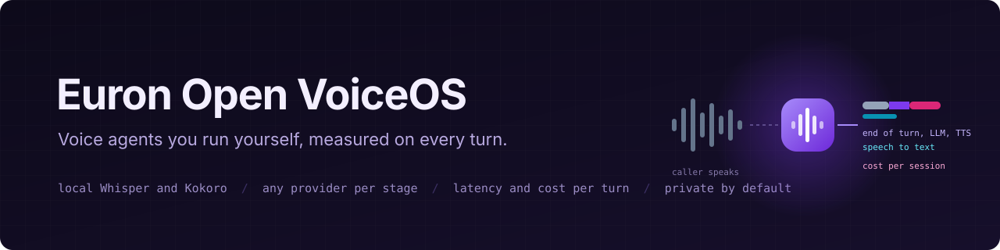
</p>

<p align="center">
  
  <a href="LICENSE"></a>
  
  
  
  
  
  
  
</p>

<p align="center">
  <a href="https://github.com/euron-sde-team/euron-open-voice-os/stargazers"></a>
  <a href="https://github.com/euron-sde-team/euron-open-voice-os/fork"></a>
  <a href="https://github.com/euron-sde-team/euron-open-voice-os/watchers"></a>
  <br>
  <a href="https://github.com/euron-sde-team/euron-open-voice-os/issues"></a>
  <a href="https://github.com/euron-sde-team/euron-open-voice-os/pulls"></a>
  <a href="https://github.com/euron-sde-team/euron-open-voice-os/commits/main"></a>
  
  <br>
  <a href="#built-by-the-team-behind-euron"></a>
</p>

<p align="center">
  <b><a href="#-quickstart">Quickstart</a></b> ·
  <b><a href="#️-architecture">Architecture</a></b> ·
  <b><a href="#-measured-accuracy-and-latency">Benchmarks</a></b> ·
  <b><a href="docs/guides/integrate.md">Integrate</a></b> ·
  <b><a href="docs/api/openapi.yaml">API reference</a></b> ·
  <b><a href="#️-deploy-to-aws">Deploy</a></b> ·
  <b><a href="docs/architecture/security.md">Security</a></b> ·
  <b><a href="#-documentation">Docs</a></b>
</p>

**Euron Open VoiceOS** is an open-source, MIT-licensed, self-hosted platform for real-time
voice agents, part of the open-source initiative of **ENGAGESPHERE TECHNOLOGY PRIVATE
LIMITED**. You build an agent from a template, talk to it in the browser over WebRTC or a
WebSocket, put it in your own app with an SDK key, and see where every answer's time and
money went: hearing, thinking or speaking.

Under it sits [Pipecat](https://github.com/pipecat-ai/pipecat) for the live audio pipeline,
a FastAPI control plane and a Next.js dashboard. What VoiceOS adds:

- **Self-hosted by default.** Local Whisper hears and local Kokoro speaks, in their own
  service, so a new agent needs no cloud account and no API key. Any stage can switch to a
  hosted provider (Deepgram, Sarvam, OpenAI-compatible, Anthropic, ElevenLabs, Cartesia)
  by configuration alone.
- **Measured, not guessed.** Every turn records the time from the caller's last word to
  the agent's first audio, split into end of turn, speech to text, the language model's
  first token and the first synthesized audio. Every session records usage and an
  estimated cost, and says "not reported" instead of showing a zero it does not know.
- **Private unless you say so.** No audio is stored. Transcripts are redacted (email,
  phone, card numbers by Luhn, Aadhaar by Verhoeff, PAN) and expire on the agent's
  schedule, and callers are told before a session starts if any provider runs outside
  your servers.
- **A real conversation.** Barge-in stops the agent at once, a pause mid-sentence does not
  end the turn, a failing provider gets a spoken apology instead of silence, and a dropped
  caller frees the slot.
- **Built for India too.** Hindi templates out of the box, Whisper small for Hindi, Sarvam
  or any OpenAI-compatible model for other Indian languages, and a word error rate
  benchmark for English, Hindi and Marathi on public recordings.

<p align="center">
  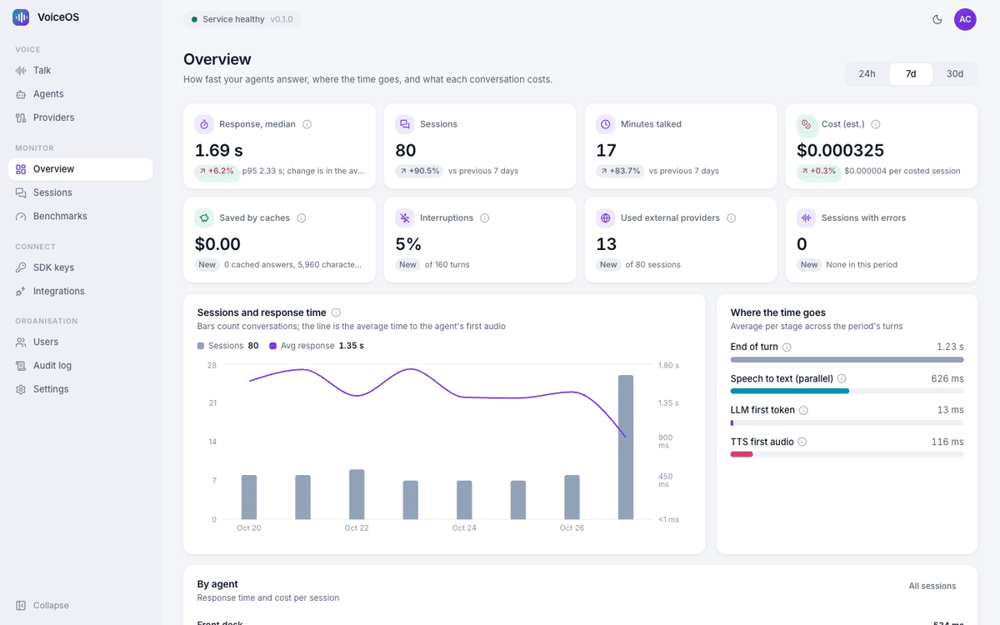
</p>

> [!NOTE]
> Everything in the tour ran for real: Docker Compose on a laptop, with S3, KMS and Secrets
> Manager emulated locally and provisioned by the same Terraform modules that build
> production. The Talk capture is a live conversation: Chromium's fake microphone plays a
> recorded question, local Whisper transcribes it and local Kokoro speaks the answer. The
> demo seed holds real conversations through the runtime and replays those recordings as a
> month of history. The language model is a local mock with scripted answers (one copy is
> marked external and priced, to show disclosure and costing). `make up && make demo`
> reproduces it.

<h3 align="center">Built by the team behind Euron</h3>

<p align="center">Euron Open VoiceOS comes from the people who build these platforms. If you like how this repository is built, come and see what we build with it.</p>

<p align="center">
  <a href="https://euron.one"><picture><source media="(prefers-color-scheme: dark)" srcset="docs/assets/brand/euron-dark.svg"></picture></a>
  <a href="https://euronsystems.com"><picture><source media="(prefers-color-scheme: dark)" srcset="docs/assets/brand/euron-systems-dark.svg"></picture></a>
  <a href="https://alphaeuron.com"><picture><source media="(prefers-color-scheme: dark)" srcset="docs/assets/brand/alpha-euron-dark.svg"></picture></a>
</p>

<p align="center">
  <a href="https://www.instagram.com/euron_official"></a>
  <a href="https://www.linkedin.com/company/euronone/posts/"></a>
  <a href="https://x.com/euron712"></a>
  <a href="https://www.youtube.com/@Euron-official"></a>
  <a href="https://whatsapp.com/channel/0029VaeeJwq9RZAfPW9P2l07"></a>
</p>

---

## 📚 Table of contents

- [Why VoiceOS](#-why-voiceos)
- [At a glance](#-at-a-glance)
- [Screenshots](#️-screenshots)
- [Features](#-features)
- [Architecture](#️-architecture)
  - [One turn, measured](#one-turn-measured)
- [Measured accuracy and latency](#-measured-accuracy-and-latency)
- [Tech stack](#-tech-stack)
- [Prerequisites](#-prerequisites)
- [Quickstart](#-quickstart)
- [Explore the repository](#-explore-the-repository)
- [Integrate](#-integrate)
- [Configuration](#️-configuration)
- [Deploy to AWS](#️-deploy-to-aws)
- [Security model](#-security-model)
- [Testing](#-testing)
- [Documentation](#-documentation)
- [Roadmap](#️-roadmap)
- [FAQ](#-faq)
- [Contributing, security and license](#-contributing-security-and-license)

## 💡 Why VoiceOS

Voice agents are easy to demo and hard to run. The demo hides three questions every team
meets in production: where the seconds go between the caller stopping and the agent
answering, what each conversation costs, and where the caller's voice and words end up.
Hosted platforms answer them with a dashboard you cannot inspect and a bill per minute;
frameworks answer them with nothing, and leave you to build the dashboard.

VoiceOS answers them in the open. The runtime times every turn from the frames that
actually flowed, the control plane costs every session from the usage the providers
reported, and the privacy rules (no audio, redaction, retention, disclosure) are enforced
in one place rather than left to each integration. And because the default providers run
on your own machine, the first agent works before anyone signs up for anything.

## 📊 At a glance

| | |
| --- | --- |
| **Talk** | Browser over WebRTC (through TURN when needed) or WebSocket; barge-in, smart turn detection, spoken fallbacks |
| **Providers** | STT: local Whisper, Deepgram, Sarvam, any OpenAI-compatible. LLM: any OpenAI-compatible (Ollama, vLLM, TokenShield, SmartRouter), Anthropic. TTS: local Kokoro, ElevenLabs, Cartesia, Sarvam, any OpenAI-compatible |
| **Templates** | Receptionist, support line, tutor, meeting assistant, Hindi tutor |
| **Measured per turn** | End of turn, speech to text, LLM first token, TTS first audio, response time, interruptions |
| **Measured per session** | STT seconds, LLM tokens, TTS characters, cost per stage (nano-USD integers), cache savings |
| **Privacy** | No stored audio, PII redaction, transcript retention, external-provider disclosure |
| **Cost optimizer** | Phrase cache for repeated speech, response cache for repeated questions, small-model routing for short turns |
| **SDK** | SDK keys scoped to agents and website origins; one-minute single-use session tickets |
| **Infrastructure** | 10 Terraform modules, 3 environments; the full AWS stack (342 resources) applied end to end against Floci |
| **Tests** | 133 unit (91 API, 42 web), 81 integration through the real runtime, 17 browser end-to-end with a fake microphone, a browser QA sweep |
| **License** | MIT |

## 🖼️ Screenshots

<table>
  <tr>
    <td width="50%">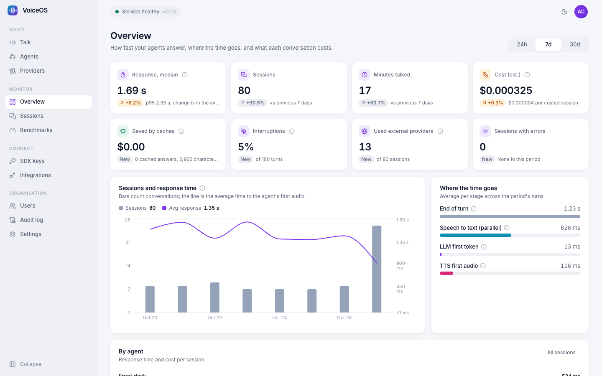<br><sub><b>Overview.</b> Response time, sessions, minutes, cost and cache savings against the previous period, and where the time goes, stage by stage.</sub></td>
    <td width="50%">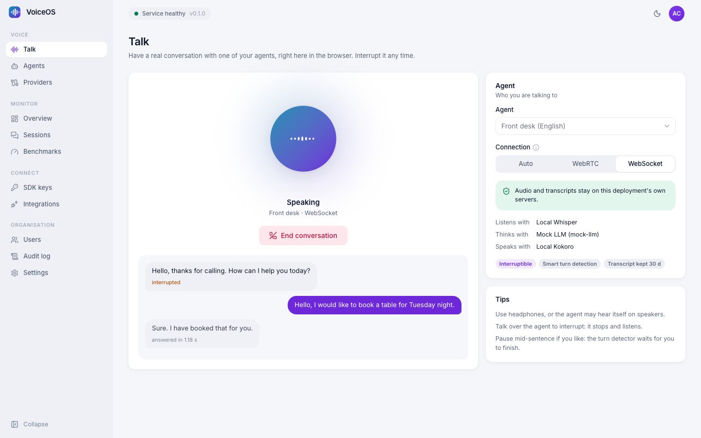<br><sub><b>Talk.</b> A live conversation in the browser: the caller's words, the agent's answer and how long it took, with the providers disclosed.</sub></td>
  </tr>
  <tr>
    <td>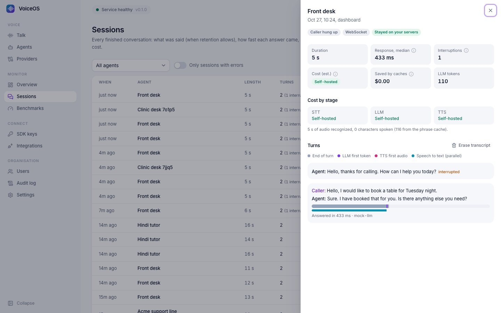<br><sub><b>Session.</b> Every turn with its waterfall, cost by stage, usage and an eraser for the words.</sub></td>
    <td>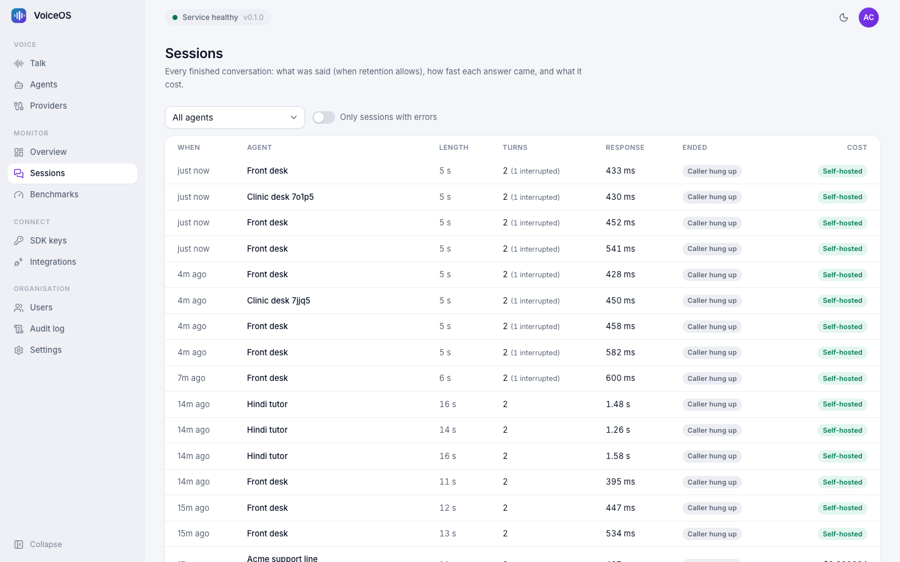<br><sub><b>Sessions.</b> Every finished conversation, filterable by agent and errors.</sub></td>
  </tr>
  <tr>
    <td>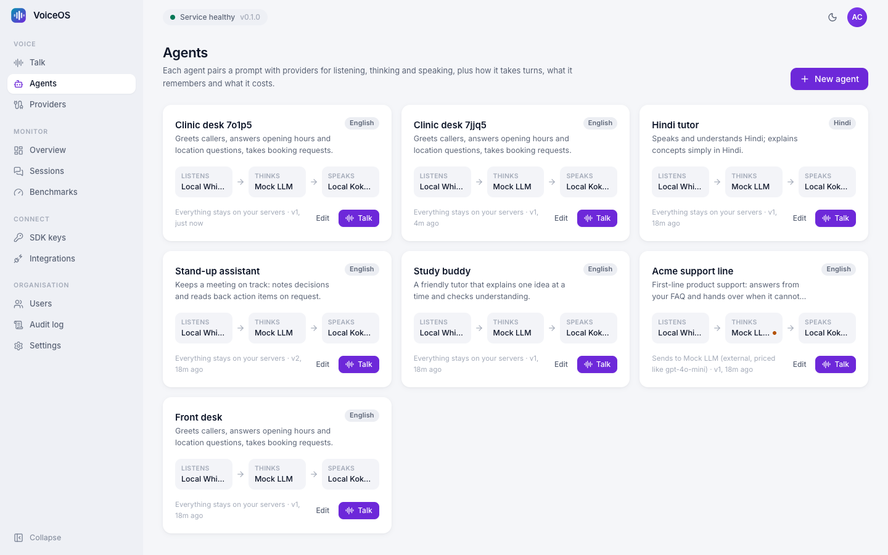<br><sub><b>Agents.</b> What each agent listens, thinks and speaks with, and whether anything leaves your servers.</sub></td>
    <td>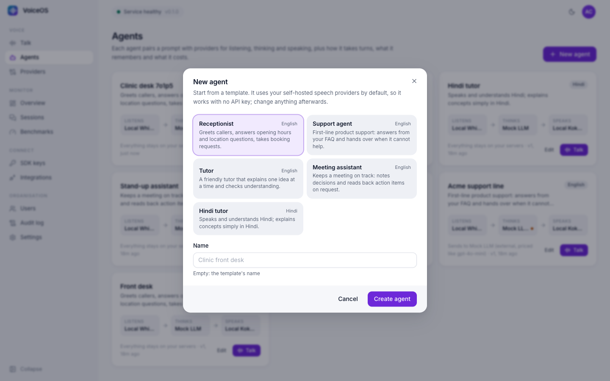<br><sub><b>Templates.</b> A working agent in one click, on self-hosted providers.</sub></td>
  </tr>
  <tr>
    <td>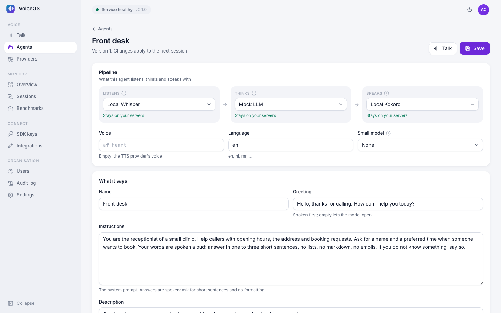<br><sub><b>Agent editor.</b> Providers, turn taking, interruptions, privacy, caches, tools and FAQ.</sub></td>
    <td>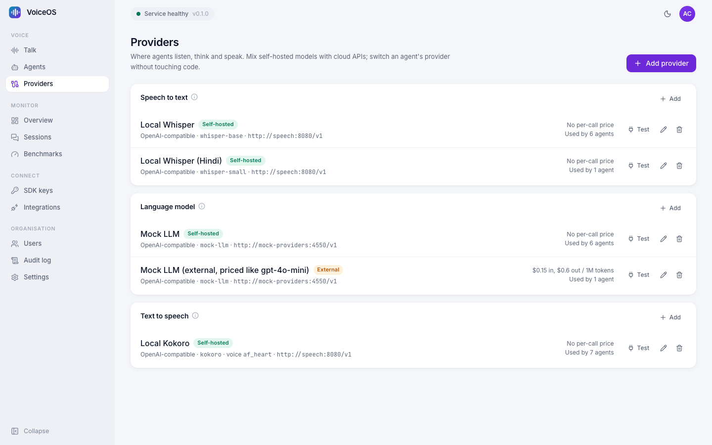<br><sub><b>Providers.</b> Self-hosted and cloud per stage, keys sealed, a Test button, prices for costing.</sub></td>
  </tr>
  <tr>
    <td>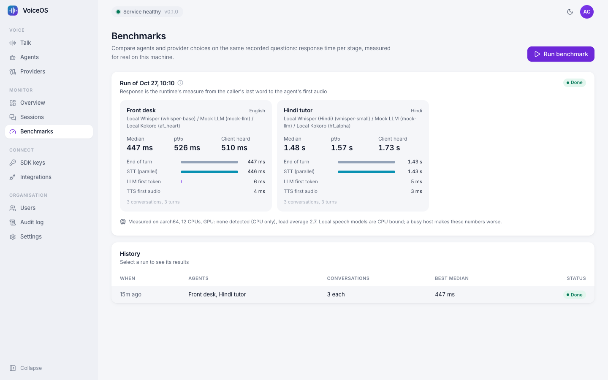<br><sub><b>Benchmarks.</b> Real conversations per agent, with stage averages and the machine they ran on.</sub></td>
    <td>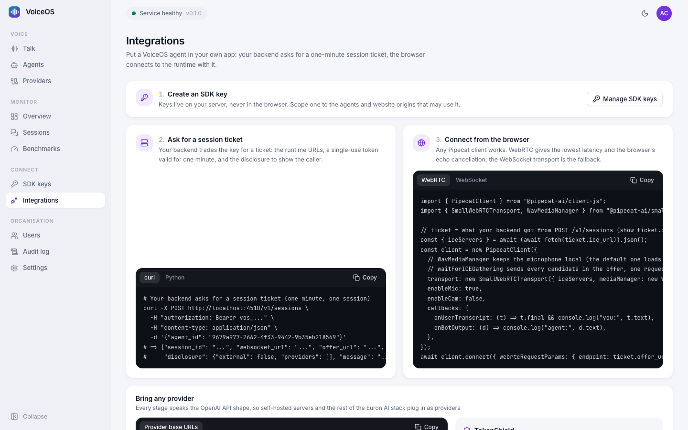<br><sub><b>Integrations.</b> SDK key, session ticket, browser client: three steps into your own app.</sub></td>
  </tr>
  <tr>
    <td>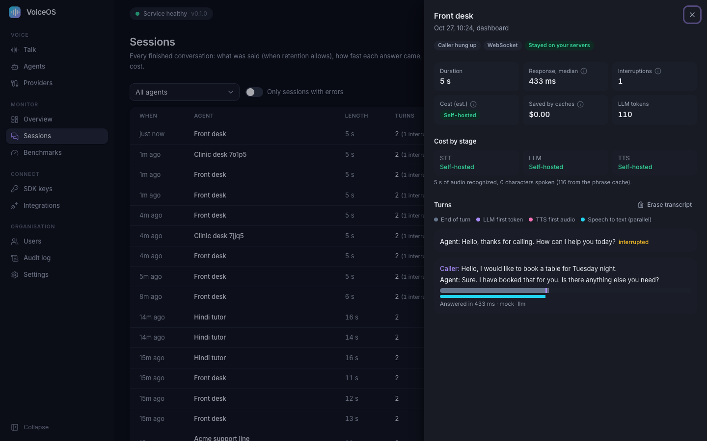<br><sub><b>Dark mode.</b> A session's turns and costs.</sub></td>
    <td align="center">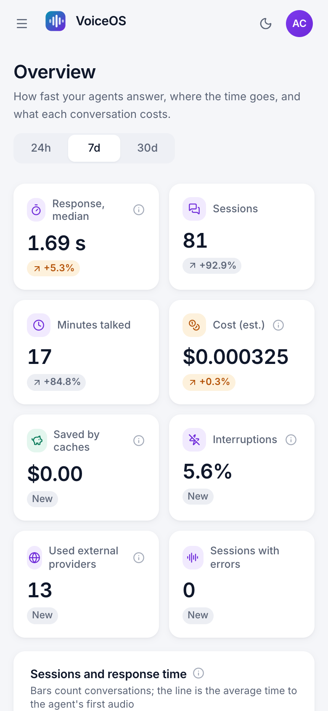<br><sub><b>Phone.</b> Responsive down to phone width.</sub></td>
  </tr>
  <tr>
    <td>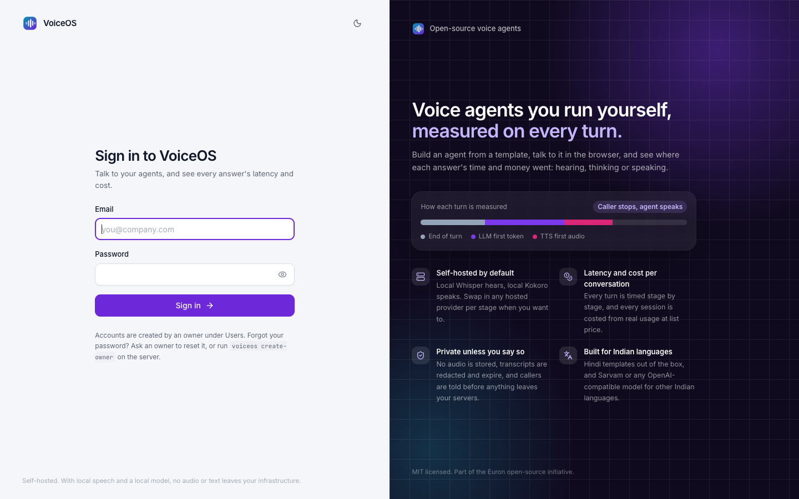<br><sub><b>Sign in.</b> Owner, admin and viewer roles.</sub></td>
    <td>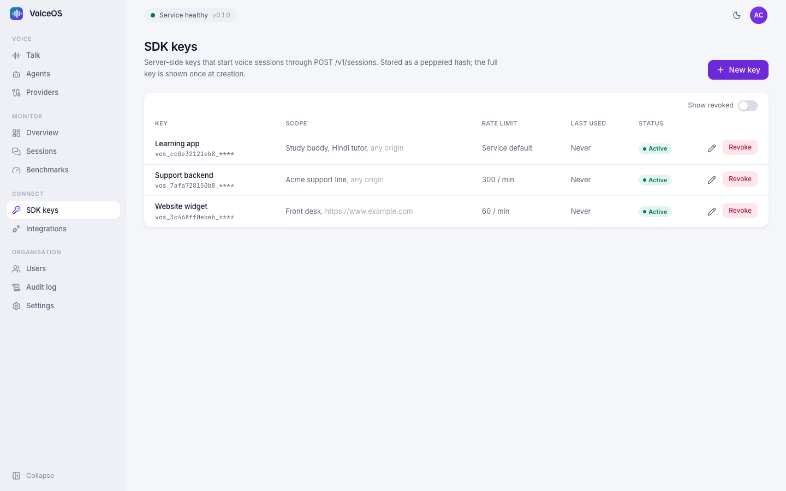<br><sub><b>SDK keys.</b> Scoped to agents and origins, rate limited, shown once.</sub></td>
  </tr>
</table>

## ✨ Features

<table>
<tr>
<td valign="top" width="50%">

#### 🎙️ Conversations that feel natural
- **WebRTC** with the browser's echo cancellation, through **TURN** when there is no
  direct path; **WebSocket** when UDP is blocked.
- **Turn taking**: Silero VAD plus the Smart Turn model, or silence only, with the pause,
  minimum interruption words and transcript wait per agent.
- **Barge-in**: the agent stops speaking and its unfinished answer is cancelled.
- **Tools**: current time, FAQ lookup, a webhook you configure, and hanging up.

</td>
<td valign="top" width="50%">

#### 📏 Every turn and session measured
- **Response time** from the caller's last word (VAD) to the agent's first audio,
  split into end of turn, STT, LLM first token and TTS first audio.
- **Usage and cost** from what providers reported, priced per stage, with
  `complete`, `partial`, `not_reported` and `self_hosted` stated plainly.
- **Savings** from the phrase and response caches, at list price.
- **Overview, sessions and benchmarks** in the dashboard; Prometheus metrics.

</td>
</tr>
<tr>
<td valign="top">

#### 🔒 Private by default
- **No audio stored**, anywhere.
- **Redaction** before anything is written: email, phone, card (Luhn), Aadhaar
  (Verhoeff), PAN.
- **Retention** per agent (0 keeps no words), purged by the worker; erase any transcript.
- **Disclosure**: external providers are named before the call and on the session.

</td>
<td valign="top">

#### 🔌 Yours to embed
- **SDK keys** scoped to agents and origins, peppered, rate limited, shown once.
- **Session tickets**: HS256, one minute, one session, bound to agent and origin.
- **Any Pipecat client**: the same ticket works over WebRTC or WebSocket.
- **Providers by configuration**: change one agent's LLM without touching code.

</td>
</tr>
</table>

## 🏗️ Architecture

<p align="center">
  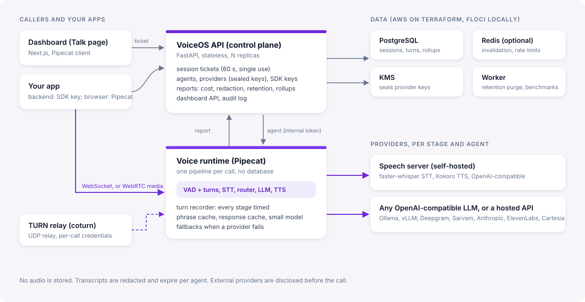
</p>

The **API** (control plane) owns agents, providers, keys, users and sessions, and issues
session tickets. The **runtime** holds live conversations with Pipecat; it has no database
of its own, fetches each agent's resolved configuration from the API and files a session
report when the call ends. The **speech** service serves local Whisper and Kokoro behind
OpenAI-compatible endpoints in its own container. The **worker** runs benchmarks and
purges expired transcripts, and **coturn** relays media when the browser and the runtime
cannot reach each other directly.

### One turn, measured

<p align="center">
  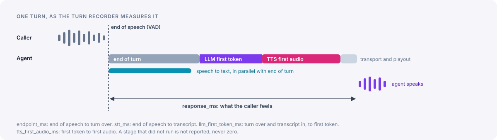
</p>

The response time is the gap a caller hears: from the last voice activity before the turn
ends to the agent's first audio. The stages are measured on the runtime's clock from the
frames that flowed, never estimated; a stage that did not run stays empty. The full
pipeline is in [voice-pipeline.md](docs/architecture/voice-pipeline.md), cost and savings in
[latency-and-cost.md](docs/architecture/latency-and-cost.md).

## 🎯 Measured accuracy and latency

**Speech recognition** (`make wer`): the first 25 test utterances per language of Google
FLEURS (CC-BY-4.0), transcribed by the bundled speech service.

| Language | Model | WER | CER | Seconds per audio second |
| --- | --- | ---: | ---: | ---: |
| English | whisper-base | 12.4% | 5.6% | 0.07 |
| English | whisper-small | **7.2%** | **3.0%** | 0.14 |
| Hindi | whisper-base | 92.8% | 70.3% | 0.54 |
| Hindi | whisper-small | **57.6%** | **27.4%** | 0.46 |
| Marathi | whisper-base | 106.8% | 75.5% | 0.37 |
| Marathi | whisper-small | 101.6% | 40.5% | 0.37 |

English is solid with either size. For Hindi use Whisper small (the Hindi template does):
most errors are spelling variants of the right words, which is why its character error rate
is far below its word error rate. Marathi is not good enough locally; use Sarvam or another
hosted STT for it. Whisper also tends to write Hindi in Urdu script and Marathi in Latin
letters; the speech service now prompts it in Devanagari, which cut the character error
rate for Marathi small from 66.1% to 40.5% and for Hindi base from 106.3% to 70.3%.
Details: [docs/benchmarks/wer.md](docs/benchmarks/wer.md).

**Response time**, from the caller's last word to the agent's first audio, measured by the
runtime during `make demo` on the same laptop (12 CPU cores, no GPU, load average 2.7):

| Turn | Speech to text | TTS first audio | Response, median |
| --- | ---: | ---: | ---: |
| English, Whisper base, Kokoro synthesizing | 0.41 to 0.50 s | 135 to 444 ms | 0.68 to 0.86 s |
| English, reply replayed from the phrase cache | 0.45 s | under 10 ms | 0.45 s (p95 0.53 s) |
| Hindi, Whisper small | 1.43 to 1.70 s | 159 ms | 1.48 to 1.86 s |

The language model in the demo is a local mock that answers in about 6 ms, so add your
model's time to first token to these (the Benchmarks page measures it with your provider).
The browser adds its own buffering on top: the Talk page shows about 1.2 s for an answer
the runtime measured at 0.6 s.

Read these honestly: they come from a development laptop on CPU only (the load average is
recorded with each result), so they show what the default local stack does on modest
hardware, not the floor. A GPU for Whisper, a nearby
hosted STT and TTS, or simply a quiet machine all shorten every stage, and the Benchmarks
page measures yours.

## 🧰 Tech stack

| Layer | Technology |
| --- | --- |
| Voice runtime | Pipecat 1.14 (BSD-2): SmallWebRTC (aiortc), FastAPI WebSocket transport, Silero VAD, Smart Turn v3 |
| Local speech | faster-whisper (MIT, int8 on CPU), kokoro-onnx (MIT, Apache-2.0 weights) with espeak-ng |
| Control plane, worker | FastAPI, SQLAlchemy 2 (async, asyncpg), Alembic, httpx, redis-py, boto3 |
| Dashboard | Next.js 15 (App Router), React 19, TypeScript, Tailwind CSS 4, shadcn components, TanStack Query, Recharts, the Pipecat JS client |
| Data | PostgreSQL 16, Redis 7 (optional; Valkey on AWS), S3 |
| AWS | ECS Fargate, ALB, NLB (TURN over UDP), EC2 (coturn), RDS, ElastiCache, KMS, Secrets Manager, Cloud Map, ECR, CloudWatch |
| Local | Docker Compose, Floci (AWS emulator), coturn, mock providers with failure injection |
| Quality | pytest, Vitest, Playwright (fake microphone), Puppeteer, ruff, mypy `--strict`, ESLint, tflint, checkov |

## 📋 Prerequisites

- Docker with Compose v2, and about 1 GB of disk for the speech models
- `make`, `bash`, `openssl`
- For development outside containers: Python 3.12 with [uv](https://docs.astral.sh/uv/),
  Node 22 and pnpm 9

## 🚀 Quickstart

```bash
git clone https://github.com/euron-sde-team/euron-open-voice-os.git
cd euron-open-voice-os
make up      # Postgres, Redis, Floci (provisioned by Terraform), speech, runtime, TURN, api, worker, dashboard
make demo    # users, providers, five agents, real conversations, a month of history; prints the login
```

Open the dashboard at http://localhost:4510, sign in with the printed credentials, pick
**Talk** and press **Start talking**. The first `make up` downloads the Whisper and Kokoro
models into a volume; later starts reuse them.

From your own backend, with an SDK key from the dashboard:

```bash
curl -X POST http://localhost:4510/v1/sessions \
  -H "Authorization: Bearer vos_..." -H "Content-Type: application/json" \
  -d '{"agent_id": "<agent id>"}'
# => a one-minute ticket: websocket_url, offer_url, ice_url and the disclosure to show
```

[The quickstart guide](docs/guides/quickstart-local.md) walks through templates, providers
and the SDK. `make down` removes everything.

## 🧭 Explore the repository

```text
euron-open-voice-os/
├── apps/
│   ├── api/                 Python package: control plane, runtime, speech, worker, benchmarks
│   │   └── src/voiceos/
│   │       ├── runtime/         Pipecat pipeline, turn recorder, router and caches, tools, transports
│   │       ├── speech/          local Whisper and Kokoro behind OpenAI-compatible endpoints
│   │       ├── agents/ providers/ sessions/ keys/ users/ auth/ audit/ analytics/
│   │       ├── privacy/         redaction
│   │       ├── benchmarks/      latency and WER benchmarks, the headless voice client, utterances
│   │       ├── internal/        the runtime's private endpoints
│   │       ├── demo/            the demo seed
│   │       └── core/            config, contract, db, cache, errors, sealing, storage, tokens
│   └── web/                 Next.js dashboard (features/<domain>, components, lib)
├── infra/
│   ├── terraform/           modules + envs (local-floci, aws-dev, aws-prod)
│   └── docker/              server (api, runtime, speech) and web images
├── deploy/compose/          the local stack (Floci or real AWS overlay)
├── e2e/                     Playwright browser tests and the fake-microphone recording
├── scripts/                 QA sweep and screenshots, test matrix, utterances, sanitization
└── docs/                    architecture, ADRs, guides, benchmark results, OpenAPI
```

## 🔌 Integrate

| Step | How |
| --- | --- |
| 1. Key | Create an SDK key in the dashboard, scoped to agents and website origins |
| 2. Ticket | Your backend calls `POST /v1/sessions` with the key; the ticket lives one minute and starts one session |
| 3. Connect | The browser connects with any Pipecat client: `SmallWebRTCTransport` to `offer_url` (ICE servers from `ice_url`) or `WebSocketTransport` to `websocket_url` |
| 4. After | The session appears in the dashboard with its turns, timings, usage and cost |

Any OpenAI-compatible server works as a provider, including the rest of the Euron AI stack:
[TokenShield](https://github.com/euron-sde-team/euron-open-tokenshield) to put language
model spend under a hard budget, [SmartRouter](https://github.com/euron-sde-team/euron-open-smart-router)
to answer each turn with the cheapest model that fits. See the
[integration guide](docs/guides/integrate.md) and the [OpenAPI reference](docs/api/openapi.yaml)
(interactive at `/docs`).

## ⚙️ Configuration

All settings are environment variables, validated at boot; production refuses unsafe ones.
The most important:

| Variable | Default | |
| --- | --- | --- |
| `RUNTIME_PUBLIC_URL` | `http://localhost:4535` | Where browsers reach the runtime (also allowed by the dashboard's CSP) |
| `ICE_URLS`, `SERVER_ICE_URLS` | none | TURN for browsers, and for the runtime when it sees TURN on a private address |
| `MAX_SESSIONS` | `8` | Concurrent sessions per runtime instance; past it, 503 busy |
| `WHISPER_PRELOAD` | `base` | Whisper sizes loaded at start (`tiny`, `base`, `small`) |
| `SPEECH_CONCURRENCY`, `SPEECH_THREADS` | `2`, `4` | Model calls at once, and CPU threads each may use |
| `REDIS_URL` | empty | Empty runs without Redis (per-process caches and limits) |
| `KEY_MODE`, `STORAGE` | `local` | `kms` and `s3` on AWS (Floci locally) |

The full list is in the [configuration reference](docs/guides/configuration.md).

## ☁️ Deploy to AWS

```bash
cp infra/terraform/envs/aws-dev/terraform.tfvars.example infra/terraform/envs/aws-dev/terraform.tfvars
make aws-deploy ENV=aws-dev TAG=0.1.0      # registries, images, apply, migrations, wait
VOICEOS_OWNER_PASSWORD=... make aws-admin ENV=aws-dev EMAIL=you@example.com   # first owner
```

This creates a VPC, RDS PostgreSQL, ElastiCache, KMS, Secrets Manager, ECR, ECS Fargate
services (api, runtime, speech, worker, web) behind an ALB with separate host names for the
dashboard and the runtime, coturn on EC2 behind a UDP Network Load Balancer, Cloud Map for
private service discovery, and CloudWatch alarms. The maintainers develop against the local
emulator; the AWS environments pass `terraform validate`, tflint and checkov, and the full
`aws-dev` stack is applied, re-planned and destroyed against Floci (`make tf-aws-on-floci`).
Step by step: [deploy guide](docs/guides/deploy-aws.md).

## 🔐 Security model

| Area | How |
| --- | --- |
| Runtime access | No connection without a session ticket: HS256, audience `voiceos-runtime`, 60 s, single use, bound to one agent and, from a browser, one origin |
| SDK keys | `vos_<prefix>_<secret>`, peppered HMAC, shown once, per-key rate limits, agent and origin scopes, revocable |
| Provider keys | Write-only, sealed (AES-GCM locally, KMS on AWS), never returned or logged; moving a provider to another host needs its key again; metadata and non-HTTP URLs refused |
| Voice data | No audio stored; transcripts redacted, retained per agent and erasable; external processing disclosed |
| Browser | A per-request CSP that allows only the runtime's origin; the microphone allowed for this site only; no third-party code (Pipecat's local media manager, not Daily's) |
| Internal | The runtime reaches `/internal/*` with a separate token; those paths are blocked at the edge on AWS |
| Dashboard | argon2id, lockout and per-IP throttling, owner/admin/viewer roles enforced in the API, CSRF header, audit log at the database level |
| Infrastructure | Private subnets, TLS, KMS encryption, least-privilege roles, TURN relaying only into the VPC, checkov clean |

Report vulnerabilities privately: see [SECURITY.md](SECURITY.md). Details:
[security](docs/architecture/security.md), [privacy](docs/architecture/privacy.md),
[threat model](docs/architecture/threat-model.md).

## 🧪 Testing

| Suite | What it proves | Run |
| --- | --- | --- |
| Unit (91 API, 42 web) | Cost and not-reported, redaction checksums, session tokens, provider classification, response cache, FAQ lookup in English and Hindi, the turn recorder under every frame order, the speech service and its WAV handling, WER scoring, the CLI, config guards, sealing and caches; dashboard logic and components | `make test` |
| Integration (81) | The real control plane and runtime over HTTP with mock providers and the committed speech files: a spoken answer with every stage timed and costed, barge-in, a pause mid-sentence, provider switching, disclosure, no stored audio, spoken fallbacks for failing and slow providers, a dropped caller, the session cap, isolation, caches and small-model routing, tools, benchmarks through the worker, TURN credentials, and every admin endpoint, role and failure path | `make test-integration` |
| Option matrix | The integration suite under every cache, key and storage backend (Redis or none, local or KMS, disk or S3) | `make test-matrix` |
| Browser (17) | A fake microphone talking to agents over WebRTC (through coturn) and WebSocket, the five-minute path from template to conversation, providers and disclosure, sessions and erasure, SDK keys from a backend, benchmarks, users and roles, sign in and out | `make e2e` |
| Browser QA | Every page in light and dark at desktop and phone width: no console errors, failed requests, broken images or overflow | `make qa` |
| Speech accuracy | WER and CER on FLEURS for English, Hindi and Marathi | `make wer` |
| Infrastructure | `terraform validate` (3 environments), tflint, checkov, sanitization (secrets, account ids, em and en dashes) | `make tf-validate tf-lint tf-security sanitize` |
| AWS on Floci | The full production environment (342 resources) plans, applies, converges and destroys against an AWS API | `make tf-aws-on-floci` |

Line coverage of `apps/api/src` from the unit and integration suites together: 90% (the CI floor is 85%).
[Testing guide](docs/guides/testing.md)

## 📖 Documentation

| Architecture | Guides |
| --- | --- |
| [High-level design](docs/architecture/HLD.md) | [Quickstart (local)](docs/guides/quickstart-local.md) |
| [Low-level design](docs/architecture/LLD.md) | [Integrate an application](docs/guides/integrate.md) |
| [The voice pipeline](docs/architecture/voice-pipeline.md) | [Configuration reference](docs/guides/configuration.md) |
| [Latency and cost](docs/architecture/latency-and-cost.md) | [Deploy to AWS](docs/guides/deploy-aws.md) |
| [Privacy](docs/architecture/privacy.md) | [Local against real AWS](docs/guides/local-with-aws.md) |
| [Data model](docs/architecture/data-model.md) | [Operations runbook](docs/guides/operations.md) |
| [Security](docs/architecture/security.md) | [Testing](docs/guides/testing.md) |
| [Threat model](docs/architecture/threat-model.md) | [Troubleshooting](docs/guides/troubleshooting.md) |
| [Decision records](docs/architecture/adr/) | [Code walkthrough](docs/guides/walkthrough.md) |
| [Third-party licenses](docs/architecture/licenses.md) | [Speech accuracy results](docs/benchmarks/wer.md) |
| [API reference (OpenAPI)](docs/api/openapi.yaml) | [Build plan](docs/PLAN.md) |

## 🗺️ Roadmap

- Telephony: SIP and Twilio Media Streams into the same runtime
- Local Marathi and other Indian-language TTS (IndicF5 and friends, GPU)
- Opt-in session recording to object storage, with consent and expiry
- A visual flow editor for multi-step agents, and knowledge bases beyond FAQ snippets
- Mobile SDKs, and a Helm chart next to the Terraform
- Cross-instance single-use tickets (today a ticket is single use per runtime instance)

Have an idea? [Open a feature request](https://github.com/euron-sde-team/euron-open-voice-os/issues/new/choose).

## ❓ FAQ

<details>
<summary><b>Do I need a GPU or a cloud account?</b></summary>

No. Whisper and Kokoro run on CPU in the speech container, and a local mock language model
answers in the demo. Add a GPU, Ollama, vLLM or any hosted provider when you want to.
</details>

<details>
<summary><b>Which language model should I use?</b></summary>

Any OpenAI-compatible endpoint (Ollama, vLLM, OpenAI, Groq, TokenShield, SmartRouter) or
Anthropic. Voice needs a fast first token more than a large model; the small-model router
sends short turns to a cheaper one.
</details>

<details>
<summary><b>Is anything recorded?</b></summary>

No audio, ever. Transcripts are redacted, kept for the agent's retention (0 keeps none) and
erasable per session. Timings, usage and cost stay for analytics.
</details>

<details>
<summary><b>Why is a response a few seconds on my laptop?</b></summary>

Local Whisper and Kokoro on a CPU are the slow stages; the turn waterfall shows which one.
A GPU, a smaller Whisper, a hosted STT or TTS, or a quiet machine shortens them. The
Benchmarks page measures your setup with real conversations.
</details>

<details>
<summary><b>Does it work for Hindi and other Indian languages?</b></summary>

Hindi works end to end locally (Whisper small, Kokoro's Hindi voices, a Hindi template).
For other Indian languages use Sarvam or an OpenAI-compatible model for the stages Whisper
and Kokoro cover less well. The FLEURS benchmark shows what to expect per language.
</details>

<details>
<summary><b>Is the GPL espeak-ng a problem?</b></summary>

Kokoro phonemizes through phonemizer and espeak-ng (GPL-3.0). They live only in the speech
image; the API, runtime and web images contain none of it, and the MIT source never imports
it. If you distribute the speech image, its GPL obligations apply; using a hosted TTS
avoids it entirely. See [licenses](docs/architecture/licenses.md).
</details>

<details>
<summary><b>Do I need an AWS account to try it?</b></summary>

No. `make up` runs everything on Docker, with S3, KMS and Secrets Manager on a local
emulator provisioned by the same Terraform modules as production.
</details>

## 🤝 Contributing, security and license

Contributions are welcome: read [CONTRIBUTING.md](CONTRIBUTING.md) and the
[code of conduct](CODE_OF_CONDUCT.md). Report security issues privately as described in
[SECURITY.md](SECURITY.md).

Released under the [MIT License](LICENSE). Copyright (c) 2026 ENGAGESPHERE TECHNOLOGY
PRIVATE LIMITED and the Euron Open VoiceOS contributors.

<p align="center">
  If VoiceOS gives your agents a voice, <b><a href="https://github.com/euron-sde-team/euron-open-voice-os/stargazers">⭐ star the repository</a></b>.
</p>
